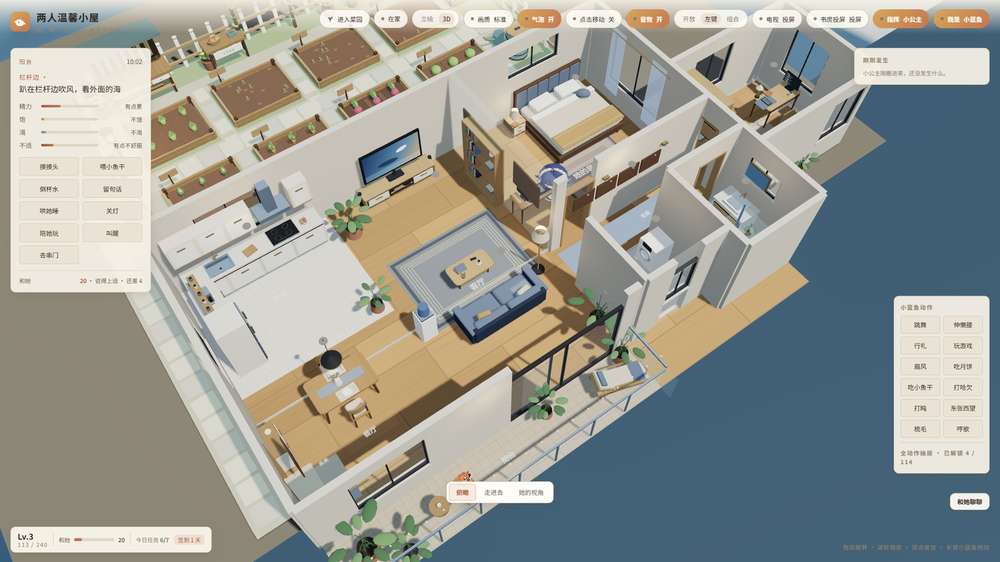
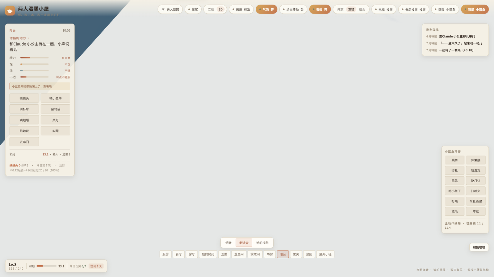
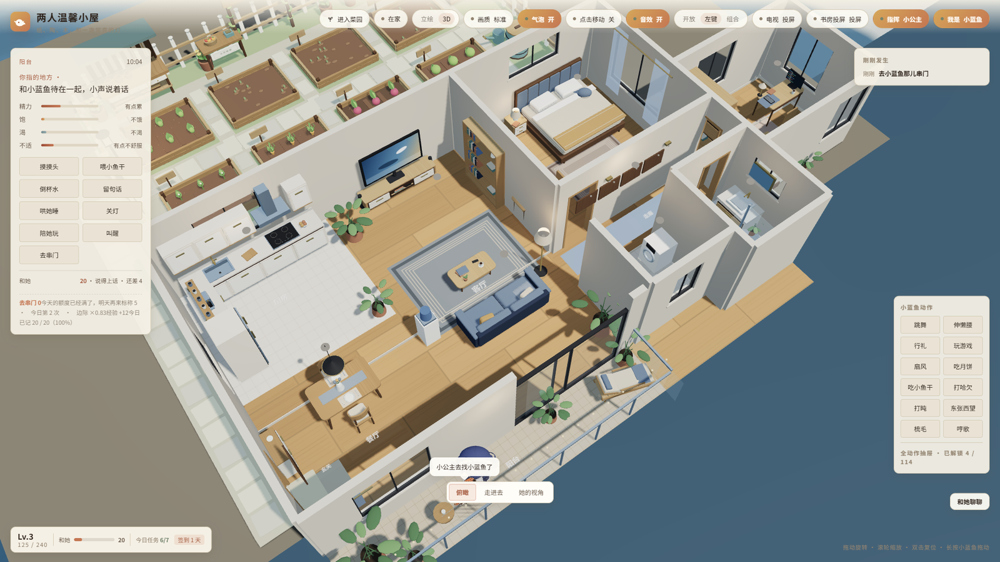
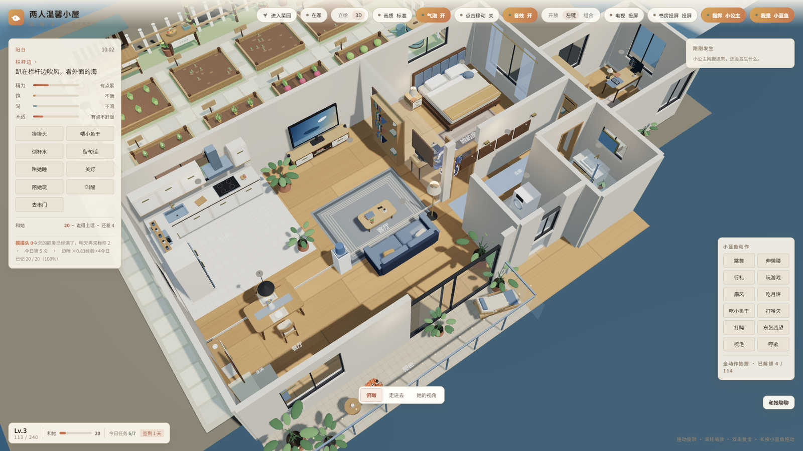
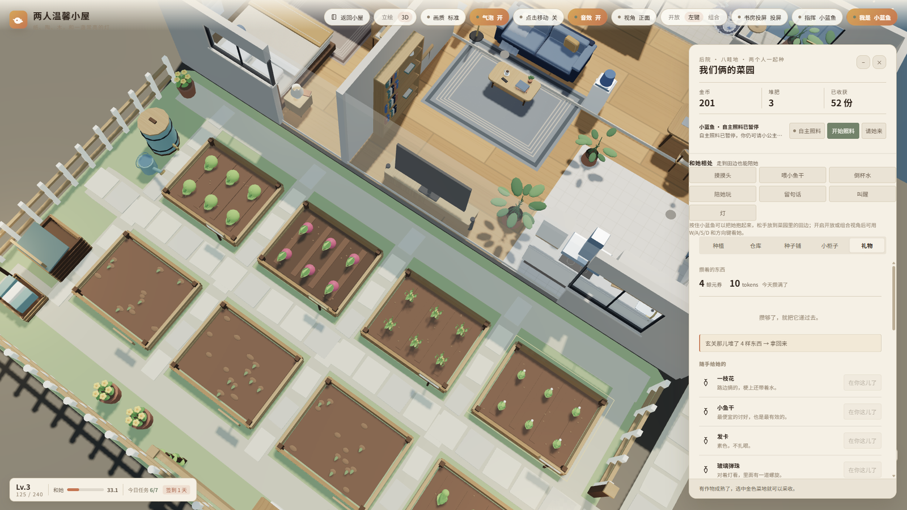
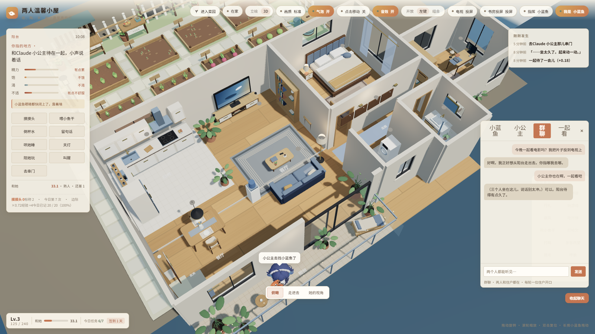
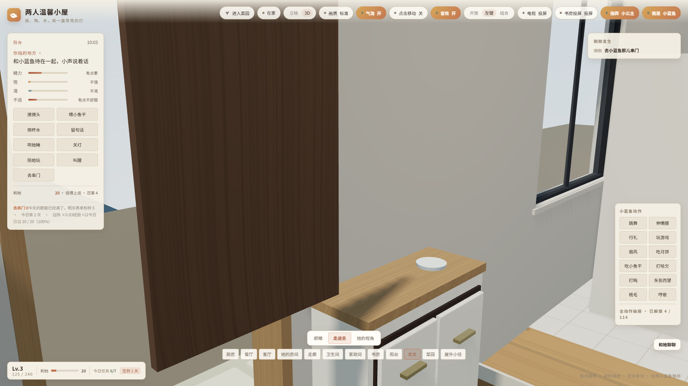
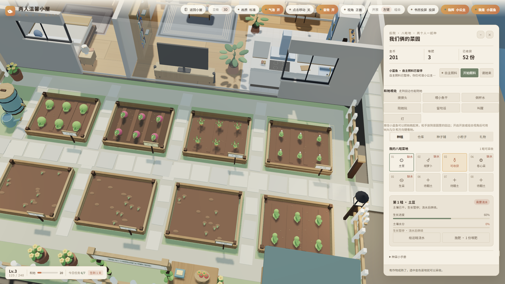

<div align="center">

# 两人温馨小屋

**一间能住人的浏览器小屋：投屏同看、亲密度、礼物、群聊、串门，异地也能共同经营。**

纸、陶、木，和一盏常亮的灯。

[](docs/intro.mp4)

<sub>3D 大平层 · 两个住户 · 一条链接就能把远方的朋友拉进同一个家</sub>

**[▶ 看项目介绍视频](docs/intro.mp4)** · **[⬇ 下载 exe](../../releases/latest)**

</div>

---

## 这是什么

这是一间跑在浏览器里的房子。你走进去，屋子里住着两个人——**小蓝鱼**，和 **Claude 大小姐**。

她们有各自的饥饿、口渴、精力、倦意，各自的日程和床铺；会自己走到厨房倒水、去书房看书、趴在桌上睡着。你可以摸摸头、喂小鱼干、递块点心、哄她睡，也可以打开电视一起看点什么，或者把一句话贴到她面前。

房子本身来自一位大佬公开的房子模板（感谢 [feiyu-room-template](https://github.com/sh2234113/feiyu-room-template)：3D 大平层、家具、菜园、相机与寻路那一套骨架是他搭的）。**在这个基础上，这一版加进了下面这些东西。**


---

## 这一版新加的东西

### 1. Claude 大小姐搬进来了

第二住户 **Claude 小公主**：铜橙长波浪卷 + 白瓣橙心雏菊发饰 + 奶油白三层蛋糕裙，2D 精灵图演出 20 段动作（待机 / 思考 / 写代码 / 看书 / 睡觉 / 开心 / 害羞 / 生气 / 裙摆舞……）。



她有独立的一套需求条与口吻：**精神 / 饱腹 / 口渴 / 倦意**，按钮叫「轻抚发梢 / 递块点心 / 劝她歇息」，动作栏叫「大小姐的姿态」。人设清冷克制、傲娇慢热。

右上角「**指挥**」一键切换当前照顾的是谁；地址加 `?as=claude` 就锁死在大小姐那一端，整套界面换成她那一套，镜头也只跟着她转。

### 2. 投屏一起看



把浏览器里的视频投到客厅电视或书房大屏上，**她会跟着一起看**：

- 电视投屏 / 书房投屏两处屏
- 50% / 80% / 全屏三档铺满
- 上一个 / 下一个 / 控制 / 跟随一起看
- 看完能让她说一句**观后感**，也能截一张「陪你一起看」的画面
- 书房那台还能顺手开一局打砖块，挡板跟鼠标，她在旁边按分数加油

### 3. 亲密度等级



不是一句空话的数字，是一本**明账**：

- `33.1 · 熟人 · 还差 1` —— 十段式亲密度阶梯
- 每次互动记「今日第几次」「边际 ×0.72」「经验 +4」，同一招刷不动
- 面板里写得清清楚楚：今天这 20 点是怎么挣的，还剩多少额度

### 4. 礼物



两种货币（**鲸元券** / **tokens**），19 件礼物分四档：随手给她的 / 攒了一阵子的 / 一直没敢拿出来的。

买了不算完——礼物会摆在**玄关**，等她什么时候愿意收。她不收，就一直在那儿。

### 5. 房间内群聊



面板里有五个标签：**小蓝鱼 / 小公主 / 群聊 / 一起看 / 她（对方）**。

群聊是屋里三个人（两个住户 + 你）坐在同一个房间里的对话，**不经过 QQ、不经过任何第三方**，就在这个屋子里。看剧时「一起看」标签还能接着聊剧情。

### 6. 串门互动



- 手动「**去串门**」：让当前角色走到另一位住户身边待一会儿
- 自己也会串：两人都闲着时约每 25~75 分钟互相串一次门，**对方睡着就轻声走开**
- 114 个动作抽屉，九组分类（互动 / 节日 / 吃 / 玩 / 演奏 / 工作 / 形象 / 待机 / 动作），点一下就就地播放

### 7. 异地共同经营



`npm run tunnel` 起一条 Cloudflare 快速隧道，房间变成一个 https 地址发给对方：

- 两个人打开的是**同一个家**（同一份存档）
- 各自身份记在自己浏览器里，**互不抢指挥**
- 右下角「屋里的人」互相可见
- 等级、亲密度、菜园、她俩今天的脾气，全在开房那台电脑上长着

---

## 项目介绍视频

[](https://github.com/6shmilzyh6/liangren-wenxin-xiaowu/releases/download/v1.0.0/liangren-intro-v1.0.0.mp4)

12 段口播，从一间大佬搭的房子讲起，到这一版往里加的东西。1920×1080，带中文字幕。

- 在线看：[**liangren-intro-v1.0.0.mp4**](https://github.com/6shmilzyh6/liangren-wenxin-xiaowu/releases/download/v1.0.0/liangren-intro-v1.0.0.mp4)
- 仓库内文件：[`docs/intro.mp4`](docs/intro.mp4)（Git LFS）

---

## 怎么玩

### 方式一：直接下载（推荐给朋友）

到 [**Releases**](../../releases/latest) 下载 `liangren-xiaowu-v1.0.0.exe`（约 120 MB），双击。

首次启动会解压到 `%LOCALAPPDATA%\dafiyu-house`，然后自动在 Edge 里开一个独立窗口（不占你的日常浏览器，不带扩展、不同步）。

启动菜单先填个名字：

- 选「**一个人住**」→ 单机，进度存在那个浏览器窗口的 localStorage
- 选「**两个人住**」→ 拿一个房间号，把号给对方，两个人进同一间屋子

### 方式二：源码跑起来

```bash
git clone https://github.com/6shmilzyh6/liangren-wenxin-xiaowu.git
cd liangren-wenxin-xiaowu
npm i
npm run dev          # 房间页 http://127.0.0.1:8787/
npm run tunnel       # 要异地共居就跑这个，给你一条 https 地址
```

---

## 屋里有什么

| | |
| --- | --- |
| **房间** | 客厅、厨房、餐厅、卧室、卫生间、家政间、书房、阳台、玄关、走廊、屋后菜园、屋外小径 |
| **相机** | 俯瞰 / 走进去 / 她的视角，拖动旋转、滚轮缩放、双击复位 |
| **住户** | 小蓝鱼（114 个立绘动作）、Claude 小公主（20 段精灵动作） |
| **共居** | 指挥切换、双人私聊、群聊、串门、异地同屋 |
| **陪伴** | 电视投屏、书房投屏、观后感、打砖块、书架抽书念一段 |
| **成长** | 十段亲密度、等级曲线、19 件礼物、22 条互动、15 个技能、114 个片段解锁门槛 |
| **菜园** | 屋后真有一块地，八畦，能进去种、能收、两个人一起照料 |

---

## 目录速览

```text
game/            打包后的游戏本体（index.html + game.js + assets）
public/room/     房间页源码（world.js / garden-*.js / actor*.js / claude-actor.js）
roles/           角色卡，claude-小公主.md 在这里
game-src/        构建、打包、验收脚本
scripts/         房子事实层 / 房间表现层 / 数值表测试
docs/            介绍视频与截图
```

---

## 素材与许可

- 房间模板与 3D 场景：来自大佬公开的 [feiyu-room-template](https://github.com/sh2234113/feiyu-room-template)，本仓库在其基础上做二次开发
- 小蓝鱼 2D 立绘：[dsh-pet](https://github.com/PC2005-cloud/dsh-pet)，**CC BY-NC-SA 4.0**
- Claude 大小姐立绘：[claudia-pet](https://github.com/kirito1207/claudia-pet)（原作 hunmer/aboutme-pets），**CC BY-NC-SA 4.0**
- 3D 模型：用户提供
- 本项目代码：MIT

**仅限非商业使用。** 所有立绘与角色设定版权归原作者，本仓库只做整合。

---

<div align="center">
<sub>灯一直亮着。你什么时候回来都行。</sub>
</div>
